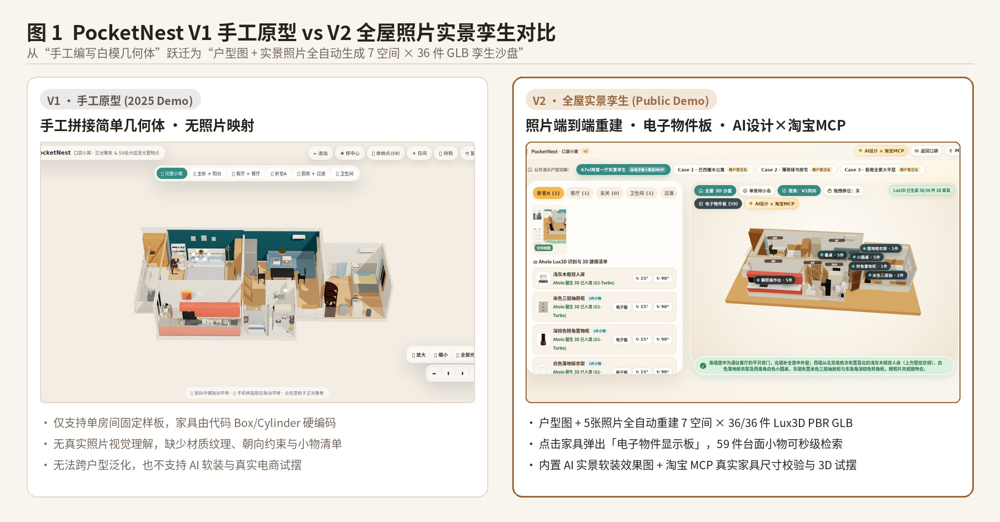
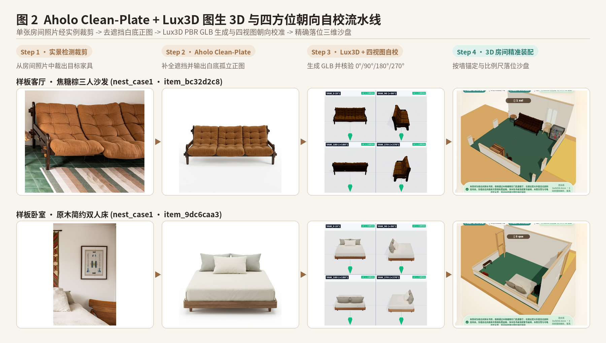
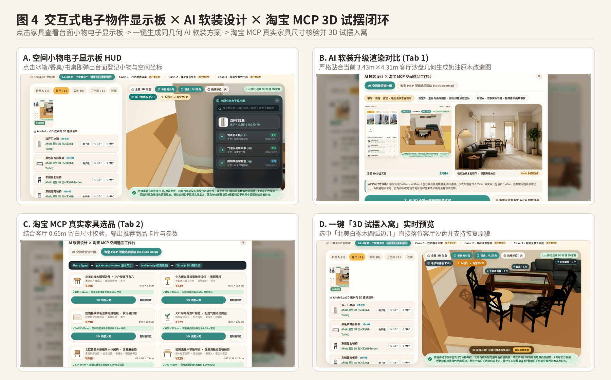
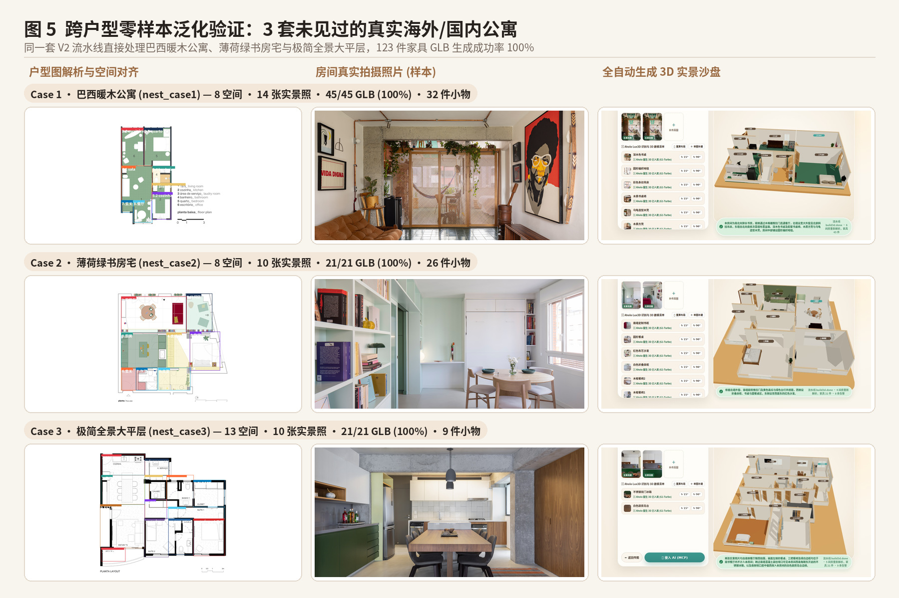

# PocketNest · 口袋小窝 (V2)

> **把任意真家装进口袋里的 3D 实景空间孪生引擎 —— 基于群核科技 Aholo Lux3D、四视图视觉定标与交互式空间记忆**

[](https://lanbafu10.github.io/PocketNest/)
[](https://lanbafu10.github.io/PocketNest/)
[-1976d2)](#实测指标与跨户型零样本泛化)

PocketNest（口袋小窝）面向普通居家用户与空间 AI 应用场景，解决传统 3D 家居建模门槛高、文生 3D 与真实物品脱节、以及 AI 助手缺乏家庭空间记忆的问题。用户只需上传 **1 张任意户型图 + 各房间实拍照片**，系统即可全自动完成户型拆解、家具单品洗白、**Aholo Lux3D** 高保真 `.glb` 生成、四视图正面视觉定标与全屋三维组装；同时内置 **空间小物电子显示板**、**AI 软装改造 × 淘宝 MCP 真实尺寸 3D 试摆** 与一键导出 **MCP (Model Context Protocol)** 能力。

👉 **免登录在线交互体验**：[`https://lanbafu10.github.io/PocketNest/`](https://lanbafu10.github.io/PocketNest/)

---

## ✨ 五大工程与算法突破

1. **Aholo Clean-Plate + Lux3D 图生 3D 稳定产线 (`aholo_client.py`, `pipeline_room.py`)**
   - 放弃不可控的 `text-to-3d`，对房间实拍图检测裁切后，先调用 Aholo `multimodal-to-image` 去除背景墙面与遮挡生成纯白底标准单品图，再送入 **Aholo Lux3D (`img-to-3d`, G1-Turbo)** 生成高还原度 `.glb` 资产。
2. **4-View GLB 证件照正面视觉定标器 (`glb_pose_calibrator.py`)**
   - ±8° OBB 微调去歪（柜/床等直角家具保持 0° 锐利轴对齐），使用无头 Chromium + 本地 Three.js 渲染 `1024×1024` 四向影棚证件照（`YAW_0 / 90 / 180 / 270` + `+Z` 朝向箭头），送入多模态视觉模型判别正面方向并缓存至 `.pose.json`，根治图生 3D 模型朝向随机难题。
3. **多锚点空间拓扑校准 + 实景照片门窗/阳台反哺 (`pipeline_floorplan.py`, `floorplan_refine.py`)**
   - `Pass1 初识 → Audit 视觉复核 → 尺度校准 → 墙体对齐` 流水线结合实景照片门窗/采光反向校准，自动补齐漏标门窗与阳台开口。
4. **父子依附复合约束布局求解器 (`pipeline_room.py`, `pose_audit.py`)**
   - 统一求解 `wall_anchor` 贴墙、`center` 居中与 `parent_id` 父子依附复合体（电视依附电视柜、台灯依附书桌、吊柜壁挂墙面），自动防止穿模并支持渲染后视觉自检。
5. **Single-Owner 免登录公开体验端 + `gltf-transform` 轻量化压缩 (`sync_public_demo.py`)**
   - 执行 `gltf-transform resize 512` 压缩贴图体积，并同步生成零后端依赖的静态交互门户，支持评委在浏览器秒级切换多套真实住宅沙盘。

---

## 🎯 两大实时交互杀手级功能

- **实景自动登记小物件与「空间小物电子显示板」 (`enrich_items_and_design.py`)**
  - 从房间实景照片中自动提取并绑定日常小物到对应 3D 家具上（67㎡ 基准小窝自动登记 **59 件**，4 套实测累计 **126 件**）。
  - 在 3D 沙盘中点击任意家具（如双开门冰箱、餐桌、书桌）即可弹出 **空间小物电子显示板 HUD**，查看存放位置、余量状态与原图溯源；支持顶部输入关键字秒搜全屋定位。
- **AI 软装改造设计图 × 淘宝 MCP 智能家具选品与「3D 试摆入窝」**
  - 读取当前房间真实沙盘几何（如客厅 `3.43m × 4.31m`、沙发东侧 `0.65m` 空位），生成同几何比例 AI 软装设计方案；
  - 联动 **淘宝 MCP (`taobao-mcp`)** 按真实长宽高尺寸匹配在售家具（如 `Ø45×52 cm 北美白橡木圆弧边几`），点击 **「3D 试摆入窝」** 直接落位三维沙盘预览，支持一键恢复实景原貌。

---

## 📊 实测指标与跨户型零样本泛化

同一套代码零手工坐标修改，端到端实测 1 套自建基准小窝 + 3 套真实海外/国内公寓：

| 项目 ID | 户型简介 | 空间数 | 实景照 | Lux3D GLB 成功率 | 自动登记小物 |
| :--- | :--- | :---: | :---: | :---: | :---: |
| `nest_test_v5` | 67㎡ 两室一厅一厨一卫（基准小窝） | 7 | 26 | **36 / 36 (100%)** | **59 件** |
| `nest_case1` | 巴西暖木公寓（葡语户型图） | 8 | 14 | **45 / 45 (100%)** | **32 件** |
| `nest_case2` | 薄荷绿书房宅（带衣帽间与推拉隔断） | 8 | 10 | **21 / 21 (100%)** | **26 件** |
| `nest_case3` | 118㎡ 极简全景大平层 | 13 | 10 | **21 / 21 (100%)** | **9 件** |
| **总计** | **4 套跨国内/海外真实住宅** | **36** | **60** | **123 / 123 (100%)** | **126 件** |

---

## 📁 目录结构

```text
pocketnest-v2/
├── backend/                     # FastAPI 全自动空间解析与 3D 建模服务
│   ├── server.py                # API 服务入口（项目管理、流水线编排、MCP 导出）
│   ├── aholo_client.py          # 群核 Aholo Clean-Plate 与 Lux3D 客户端封装
│   ├── pipeline_floorplan.py    # 户型图多阶段解析与门窗拓扑构建
│   ├── floorplan_refine.py      # 实景照片门窗/阳台反哺与拓扑精细化校准
│   ├── pipeline_room.py         # 实拍物体检测、Clean-Plate、Lux3D 与父子布局求解
│   ├── glb_pose_calibrator.py   # 4-View GLB 证件照正面视觉定标器
│   ├── pose_audit.py            # 多角度渲染自检闭环
│   ├── enrich_items_and_design.py # 空间小物电子显示板、AI 软装方案与淘宝 MCP 联动
│   ├── pipeline_common.py       # 公共几何工具与环境变量配置
│   └── sync_public_demo.py      # gltf-transform 压缩与免登录静态演示端同步
├── frontend/                    # Three.js WebGL 2.0 交互式 3D 沙盘前端
│   ├── index.html               # 单文件轻量化前端（含电子显示板、淘宝 MCP 3D 试摆、MCP 弹窗）
│   └── vendor/                  # 本地化 Three.js 与 GLTFLoader 依赖
└── docs/
    └── V2_CALIBRATION_REPORT.md # 建模校准与泛化测试报告
```

---

## 🚀 快速部署

### 1. 环境准备

```bash
python3 -m venv .venv && source .venv/bin/activate
pip install fastapi uvicorn httpx pillow pydantic playwright
playwright install chromium
npm install -g @gltf-transform/cli
```

### 2. 配置环境变量（请勿提交真实密钥）

```bash
export AHOLO_APP_KEY="your_aholo_app_key"
export AHOLO_APP_SECRET="your_aholo_app_secret"
export VLM_API_BASE="https://api.openai.com/v1"
export VLM_API_KEY="your_vlm_api_key"
```

### 3. 启动服务

```bash
uvicorn server:app --host 127.0.0.1 --port 18792
```

---

## 📄 开源协议

MIT License


---

## 🖼️ 实测效果与核心亮点预览

| V1 手搓 Demo vs V2 任意户型全自动 3D 孪生 | Aholo 多模态去杂 + Lux3D 四向自定标流水线 |
| :---: | :---: |
|  |  |

| 空间物件电子显示板 + AI 软装设计 × 淘宝 MCP 试摆 | 3 套外部真实住宅跨户型零微调泛化测试 |
| :---: | :---: |
|  |  |
